# Notch

Notch turns the top of your Mac's screen into a live "island" and puts widgets on the real macOS lock screen. It runs from the menu bar and uses live data from your Mac.

- **Island:** album art and a waveform while music plays; volume and brightness levels; charging, low battery, AirPods/Bluetooth connections, timer, Focus and calendar alerts; other apps' notifications (optional). Hover or click to open a player with seek, like/shuffle/repeat and output-device switching, plus pages for widgets, a file shelf (with AirDrop) and a timer. When nothing is playing (or a song has been paused for a few seconds) the closed island shows the weather, "Not playing" or nothing (Settings › Island › Behaviour › More options).
- **File shelf:** drop anything on the notch (files, folders, images, links, text; several at once) and drag it back out later. It holds the 10 newest items and keeps them across launches.
- **Lock screen:** weather, air quality, Mac and AirPods/Bluetooth batteries, next event and forecast, and a working music player. You can place everything in a live preview of your own lock screen.
- **Optional desktop widgets**, Discord "Listening to…" status, and Spotify extras.

On a MacBook with a notch the island fits the notch exactly. On Macs without one (older MacBooks, iMac, Mac mini, Mac Studio, or an external display as the main screen) it shows as a small pill at the top centre of the main screen.

## Screenshots

**The island**: open player, compact while music plays, and live activities:

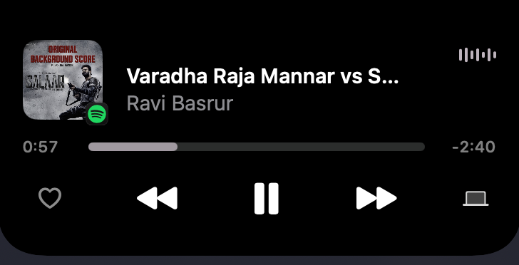

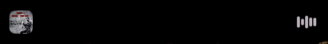

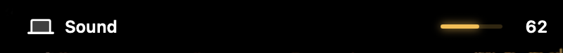
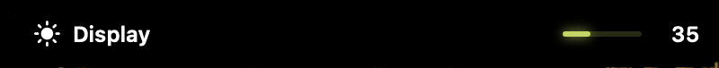
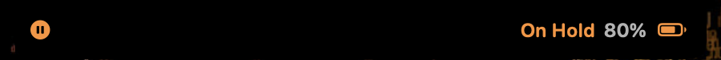
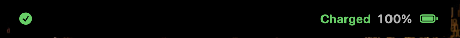

| Welcome | Settings |
|---|---|
| 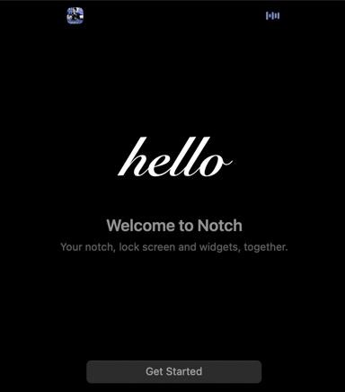 | 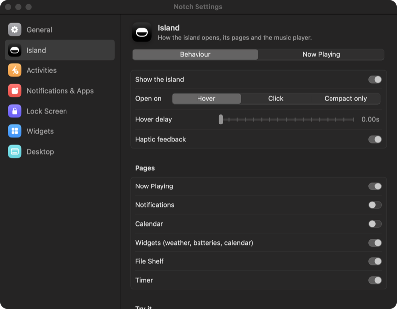 |

Lock-screen widgets (round, glass, cards, light):

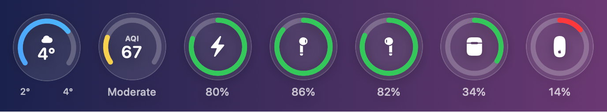
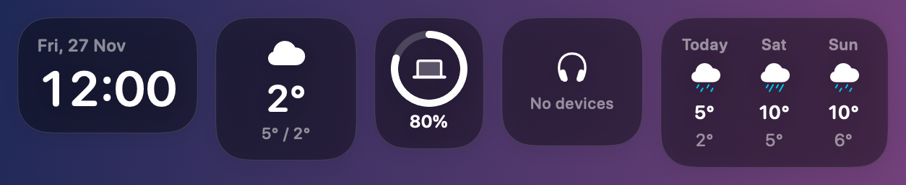
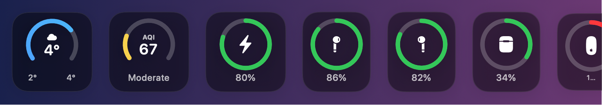
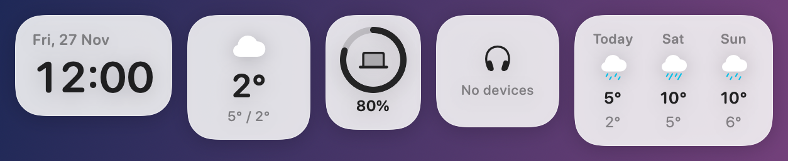

## Requirements

- macOS 14 Sonoma or later
- Apple Silicon or Intel (the app is built as a universal binary when the toolchain supports it; see Build)

## Install

1. Open `Notch.dmg` and drag **Notch** to **Applications**.
2. Notch is not notarised by Apple, so the first time you open it macOS will block it:
   - **Right-click (or Control-click) Notch in Applications → Open → Open**, or
   - open it once, then go to **System Settings › Privacy & Security**, scroll down and click **Open Anyway**.
3. A short welcome explains the features and asks for the permissions they need. Notch then lives in the menu bar and starts at login (turn this off in Settings › General).

Opening Notch again (from Finder or Spotlight) shows its Settings.

## First-time setup

1. Open Notch. It grows out of your notch and says hello.
2. **Choose your features**: island, lock-screen widgets, notifications, volume and brightness, calendar, desktop widgets, Spotify likes & devices. Everything can be changed later.
3. **Allow permissions**: only the ones your features need are listed, each with an Allow button (it shows the system prompt, or opens the right page in System Settings).
4. **Connect Spotify** (only if you picked it): paste your own Client ID (see Integrations below).
5. Point at the notch to open the island, right-click it for Settings, and lock your Mac to see your widgets.

You can replay this any time from **Settings › General › Show Welcome**.

## Permissions

Everything works without permissions; each one only turns on the features listed next to it. Grant them in **System Settings › Privacy & Security**.

| Permission | Used for | Without it |
|---|---|---|
| Accessibility | Replacing the system volume/brightness display with the island; instant Mission Control hiding | macOS shows its own volume/brightness display |
| Location | Local weather | Weather for your time-zone city, or a city you set in Settings |
| Calendars | Next event, calendar page and event alerts | Calendar widgets show a hint instead |
| Bluetooth | Alert when AirPods or other devices connect | No connection alert (battery levels still show) |
| Automation (Music, Spotify, your browser) | Shuffle/repeat for Music and Spotify, controls and artwork if the Now Playing helper can't run; like/repeat for YouTube Music in a browser (also needs the browser's "Allow JavaScript from Apple Events"). Never launches an app that isn't running | Asked only when needed |
| Full Disk Access | Showing other apps' notifications and Focus status in the island (Settings › Notifications & Apps, off by default). Read-only; nothing is stored | Notification mirroring stays off |

Weather and air quality come from [Open-Meteo](https://open-meteo.com) (no account). With no internet connection the weather widgets show "No weather" and retry every couple of minutes.

### Integrations (optional, Settings › Notifications & Apps)

- **Discord:** create a free application in the Discord Developer Portal and paste its Application ID. The Discord app must be running.
- **Spotify:** adds Like and Spotify Connect devices. Create an app in the Spotify Developer Dashboard, add the Redirect URI shown in Settings, paste your own Client ID and click Connect. Without it, Spotify still plays and shows in the island.

## Build from source

You need the Xcode Command Line Tools (`xcode-select --install`, Swift 6) on macOS 14 or later. Xcode itself isn't needed.

```sh
./Scripts/package-app.sh          # builds Notch.app in the repo folder
./Scripts/create-dmg.sh           # builds Notch.app and Notch.dmg
swift test                        # unit tests
```

- `package-app.sh` builds arm64 and x86_64 and joins them into a universal app. If one architecture can't be built on your machine it is left out with a warning; `ARCHS=arm64 ./Scripts/package-app.sh` builds just one.
- Optional: `./Scripts/create-signing-cert.sh` (run once) creates a local self-signed identity, "LockWidgets Local Signing". With it, macOS remembers the permissions you granted across rebuilds. Without it the app is signed ad-hoc, and you may need to grant permissions again after each rebuild.

## Notes

- Notch uses **private macOS APIs** (SkyLight for the lock-screen layer, MediaRemote for system-wide Now Playing, DisplayServices for brightness). It can't be on the Mac App Store, and a future macOS update could break a feature. Each one switches off quietly if its API is missing.
- On macOS 15.4 and later, only Apple-signed processes may read system-wide Now Playing. Notch loads a small helper into Apple's `/usr/bin/perl` for this. If the helper can't run, Now Playing falls back to Music and Spotify only.
- Notification mirroring reads the system notification database (read-only) and keeps only the last few in memory.
